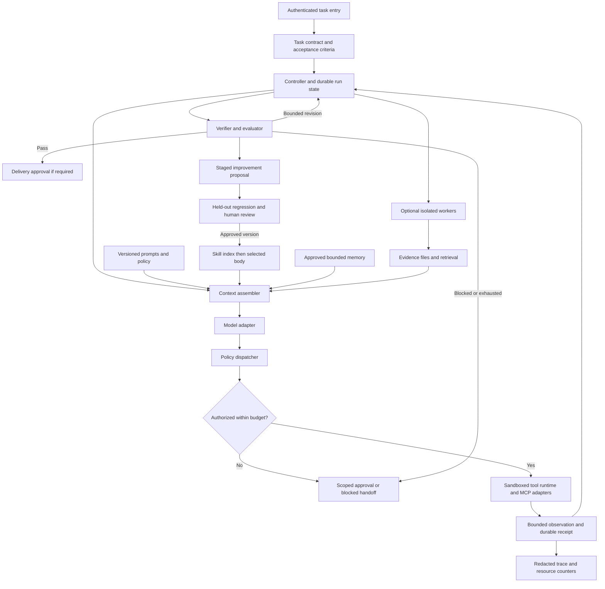

# Reference architecture for Aman's agents

Keep execution policy outside model-generated text. This design combines first-party loop, context, memory, and tool guidance. It is a proposed architecture, not a vendor implementation or locally validated system.

## Component contracts

| Component | Required state and responsibility |
|---|---|
| Task contract | Objective, deliverables, authorized resources, prohibited actions, budget, stop conditions, evidence standard, acceptance checks |
| Controller | Run ID, task version, events, cancellation, retries, global counters, checkpoints, no-progress detection |
| Prompt registry | Short stable base policy, role prompt, repository adapter, version and rollback pointer |
| Skill registry | Name/description discovery, version/hash, selected body and one-hop supporting files |
| Context assembler | Trust labels, evidence provenance, relevance selection, context budget, handoff |
| Memory manager | Separate preferences, accepted decisions, task observations, and procedural candidates; record retention and supersession |
| Dispatcher | Validate schemas, identity, tenant/resource scope, risk class, approval, budget independently of model text |
| Runtime | Scoped secrets, filesystem/network boundaries, timeout, idempotency, receipts |
| Worker manager | Objective, scope, evidence packet, isolated scratchpad, bounded output and resource allocation |
| Verifier | Deterministic checks first; factual or role rubric second; report missing checks explicitly |
| Observability | Trace/model/tool versions, costs, latency, permission decisions, redaction |
| Improvement pipeline | Proposed diff, before/after evals, authorized promotion, rollback; generator cannot weaken its own tests |

## Data flow

The entry point authenticates the requester and creates a versioned contract. The controller selects context, then requests a model action. The dispatcher rejects actions outside the contract before execution. The runtime returns an observation plus an execution receipt. The controller updates state and asks the verifier whether requirements were met.

Save the contract, append-only events, progress, raw evidence, and final artifacts under a run identifier. Save accepted durable facts outside the run with provenance and retention rules. Directory names alone do not provide tenant isolation.

Start with no workers. Add at most three research workers only when decomposition identifies independent questions. This is a proposed initial profile. Set actual cost/time/call ceilings from observed tasks rather than vendor token budgets.

Require human approval for publication, paid spend, production mutation, destructive actions, and active security testing. Resolve credentials in the runtime, never in skills or prompts. Stage skill changes after the run and evaluate them before promotion.

Sources: Anthropic effective agents/context/tools/research; Codex loop; Manus; Hermes; OpenClaw; Letta; LangGraph, listed in [sources](../sources.md). Initial budgets and promotion topology are local synthesis.
