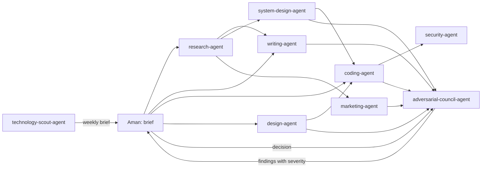

# Agents

Nine agent definitions. Each folder is a complete, paste-ready package: a system prompt, an operating workflow, the skills the agent loads, review checklists, eval cases, and the sources behind every rule. None of them has been run against Aman's own repositories, inboxes, or products yet; the eval cases exist so that the first runs produce evidence instead of impressions.

Every folder follows the same layout:

| File or folder | What it holds |
|---|---|
| `README.md` | What is inside, item by item |
| `FOR-AMAN.md` | The framing to give, the inputs to supply, the access to grant and refuse, the gates, the eval to run first |
| `SYSTEM-PROMPT.md` | The prompt to paste into the agent's system slot. Self-contained; no hidden dependencies on other files |
| `WORKFLOW.md` | Phases, approval gates, handoffs to other agents, failure handling |
| `skills/` | Skills in the Agent Skills format (`SKILL.md` with name and description front matter). Original skills live at the top level; adapted upstream skills live under `skills/vendored/<owner>/` with `SOURCE.md` and the upstream licence |
| `checklists/` | Review lists a human or a reviewer agent can walk through |
| `evals/` | YAML cases: `id`, `agent`, `title`, `task`, `inputs`, `gold`, `rubric`, `judge`, `anti_patterns`, `source`, `as_of` |
| `sources.md` | Every source with URL, date, and what was taken from it |

## The roster

| Agent | Job in one line | Original skills | Vendored skills | Eval cases |
|---|---|---|---|---|
| [writing-agent](writing-agent/) | Draft Aman's personal messages, professional writing, and articles in his voice without inventing his facts; carries the AI-slop catalogue (102 before/after pairs) and the Clark 2026 readability checks | 3 | 0 (humanizer and Anthropic skills studied, cited) | 9 |
| [research-agent](research-agent/) | Answer a question or support a decision with inspectable evidence: claim-level citations, source grading, disagreement recorded, not smoothed over | 5 | 0 | 8 |
| [coding-agent](coding-agent/) | Scoped repository changes with executable acceptance checks, least-privilege permissions, and hooks that stop the common failure modes | 4 | 8 (Superpowers, Addy Osmani; MIT) | 11 |
| [design-agent](design-agent/) | Task-specific interfaces from a brief, a token plan, and screenshot critique; 68 design-slop tells to avoid the generic AI look | 3 | 7 (Anthropic design skills; Apache-2.0) | 6 |
| [security-agent](security-agent/) | Review authorised changes, hunt vulnerabilities in isolated replicas, assess designs; every finding needs an attacker path and evidence | 4 | 4 packages from 3 upstreams (Anthropic review prompt, MIT; two Trail of Bits skills, CC-BY-SA-4.0; Sentry authorization reference, Apache-2.0 root with a CC-BY-SA-4.0 OWASP-derived file) | 10 |
| [adversarial-council-agent](adversarial-council-agent/) | Independent reviewers with opposed roles, blind to each other, producing located findings with severity; separate repair verification | 3 | 0 (Karpathy's llm-council linked, unlicensed) | 8 |
| [system-design-agent](system-design-agent/) | Turn a product brief into a minimal architecture and implementation-ready contracts; designs and reviews, never deploys | 2 | 0 | 6 |
| [marketing-agent](marketing-agent/) | Evidence-backed positioning and reviewable drafts (landing copy, launch posts, emails); 20 editing pairs; never publishes on its own | 3 | 0 | 8 |
| [technology-scout-agent](technology-scout-agent/) | A weekly brief of at most five decision-relevant changes in models, harnesses, and tools, with a weighted watchlist; an empty shortlist is valid | 1 | 0 | 6 |

Counts are as of 2026-10-25 and come from `find`. The skills library in `01-skills-library/` holds 160-plus further skills that any of these agents can load on demand; each agent's `FOR-AMAN.md` says which ones it should.

## How the agents hand off

Three rules hold across the roster. The council reviews, it does not produce. The security agent reviews code the coding agent wrote, never its own. Anything that leaves the sandbox (send, publish, deploy, delete, pay) waits for Aman.

## Suggested build order

1. `writing-agent`: Aman already has the data (his own messages and articles) and the eval is cheap to judge by eye.
2. `research-agent`: everything downstream consumes its evidence format.
3. `coding-agent`: the largest daily time saving once the permission model and hooks are in place.
4. `adversarial-council-agent`: start reviewing the first three before scaling them.
5. `security-agent`, `design-agent`, `system-design-agent`, `marketing-agent`, `technology-scout-agent`: in whichever order the next project needs.

## Not here yet

A data-analysis agent and a personal-operations agent (calendar, inbox triage) were considered and deferred: the sources for them are thinner and the access they need is the most sensitive. `00-foundations/agent-architectures/` has the patterns to build them from when the time comes.
